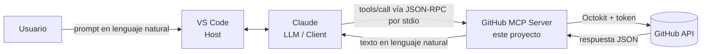

# GitHub MCP Server

MCP Server en **Node.js + TypeScript** que permite a un agente de IA (Claude) ejecutar operaciones reales en **GitHub** usando lenguaje natural: crear repositorios, abrir issues, hacer commits y más.

Proyecto Integrador M5 – Henry Full Stack · _AutomateHub_

---

## ¿Qué hace?

Expone **8 tools** a través del [Model Context Protocol (MCP)](https://modelcontextprotocol.io). Un host compatible (VS Code con Claude) se conecta al server por **stdio**, el LLM lee las descripciones de los tools y decide cuál usar según lo que pide el usuario.

> Usuario: _"Creá un repo llamado `demo-mcp` y abrile un issue que diga 'Agregar tests'"_
> → Claude llama a `create_repository` y luego a `create_issue`. Las acciones quedan hechas en GitHub.

## ¿Por qué es útil?

- **Automatizar tareas repetitivas**: crear repos con README inicial, abrir issues en serie, actualizar archivos sin salir del editor.
- **Lenguaje natural en lugar de comandos**: no hace falta recordar la sintaxis de `git` o de la API.
- **Triage rápido**: "¿Qué issues abiertos tiene mi repo X?" y cerrarlos o comentarlos desde el chat.
- **Documentación al vuelo**: "Agregá un archivo `CONTRIBUTING.md` con estas reglas" → commit directo.

---

## Arquitectura



```
VS Code (Host)            gestiona la sesión y lanza el server como proceso hijo
   │
Claude (LLM / Client)     lee el prompt, elige el tool y arma los parámetros
   │  JSON-RPC por stdio
MCP Server (este repo)    valida con Zod → llama a GitHub → traduce errores
   │  HTTPS (Octokit)
GitHub API                ejecuta la acción y devuelve el resultado
```

Flujo interno de una llamada:

```
server.ts → tools/*.ts → schemas (Zod) → github/operations.ts → utils/retry.ts → github/client.ts (Octokit)
                                                  ↓ si falla
                                          errors/index.ts (mensaje en lenguaje natural)
```

### Estructura del proyecto

```
src/
├── server.ts              # Entry point: crea el McpServer, registra tools, conecta por stdio
├── types.ts               # Tipos compartidos (RepositorySummary, IssueSummary, ...)
├── tools/                 # Un archivo por tool: nombre + descripción + schema + handler
├── schemas/index.ts       # Schemas de Zod y helper validateInput()
├── github/
│   ├── client.ts          # Crea Octokit con el token (separado para poder mockearlo)
│   └── operations.ts      # Lógica de negocio: llamadas a la API de GitHub
├── errors/index.ts        # ValidationError, AuthenticationError, GitHubAPIError, NetworkError
└── utils/
    ├── logging.ts         # Logger a stderr que oculta tokens
    ├── retry.ts           # Exponential backoff para rate limit / red
    └── response.ts        # Arma las respuestas para el LLM
tests/
├── tools.test.ts          # Validación de schemas
├── github.test.ts         # Operaciones con Octokit mockeado
└── errors.test.ts         # Transformación de errores, retry y logs
```

---

## Requisitos

- **Node.js 18 o superior** (`node -v`)
- **npm** (viene con Node)
- **Visual Studio Code** actualizado
- Una de estas dos opciones para usar Claude dentro de VS Code:
  - **Extensión Claude Code** (requiere cuenta de Claude con plan pago), o
  - **GitHub Copilot** en modo _Agent_ con un modelo Claude seleccionado
- Una cuenta de **GitHub** y un **Personal Access Token**

---

## Instalación

```bash
git clone https://github.com/<tu-usuario>/github-mcp-server.git
cd github-mcp-server
npm install
npm run build        # compila TypeScript a la carpeta dist/
```

---

## Configuración

### 1. Obtener un GitHub Personal Access Token

1. Entrá a GitHub → foto de perfil → **Settings**.
2. Abajo de todo: **Developer settings** → **Personal access tokens** → **Tokens (classic)**.
3. **Generate new token** → **Generate new token (classic)**.
4. Poné un nombre (ej: `mcp-server`) y una expiración (ej: 30 días).
5. Marcá los scopes:

| Scope | Para qué se usa |
|-------|-----------------|
| `repo` | Crear repos, leer/crear issues, hacer commits (incluye repos privados) |
| `user` | Leer el usuario autenticado (para saber el `owner` por defecto) |
| `admin:org` | Operar sobre repos de organizaciones |

6. **Generate token** y copialo (empieza con `ghp_`). GitHub no lo vuelve a mostrar.

> ⚠️ Nunca subas el token al repositorio. Si se sube por error, **revocalo inmediatamente** desde la misma pantalla.

### 2. Configurar `.env`

```bash
cp .env.example .env
```

Editá `.env`:

```env
GITHUB_TOKEN=ghp_tu_token_real
LOG_LEVEL=info
```

`.env` está en `.gitignore`, así que no se commitea.

### 3. Configurar el MCP server en VS Code

El server se ejecuta con `node dist/server.js` (por eso hay que hacer `npm run build` antes). El token se lee del `.env` automáticamente.

#### Opción A – Extensión Claude Code (recomendada)

El repo ya incluye `.mcp.json` en la raíz:

```json
{
  "mcpServers": {
    "github-mcp": {
      "command": "node",
      "args": ["dist/server.js"]
    }
  }
}
```

1. Instalá la extensión **Claude Code** desde el Marketplace de VS Code e iniciá sesión.
2. Abrí la carpeta del proyecto en VS Code (`File → Open Folder`).
3. Abrí el panel de Claude Code. La primera vez te pide aprobar el server `github-mcp` del proyecto: aceptá.
4. Escribí `/mcp` en el chat para verificar que `github-mcp` aparece **conectado** con sus 8 tools.

> Alternativa por terminal (registra el server con ruta absoluta):
> `claude mcp add github-mcp -- node /ruta/completa/github-mcp-server/dist/server.js`

#### Opción B – GitHub Copilot (modo Agent) con modelo Claude

El repo ya incluye `.vscode/mcp.json`:

```json
{
  "servers": {
    "github-mcp": {
      "type": "stdio",
      "command": "node",
      "args": ["${workspaceFolder}/dist/server.js"],
      "envFile": "${workspaceFolder}/.env"
    }
  }
}
```

1. Abrí `.vscode/mcp.json` y hacé clic en **Start** sobre `github-mcp` (o `Ctrl+Shift+P` → **MCP: List Servers** → Start).
2. Abrí el chat de Copilot, cambiá a modo **Agent** y elegí un modelo **Claude** en el selector.
3. En el ícono de herramientas 🛠️ verificá que aparecen los tools de `github-mcp`.

### 4. Verificar con MCP Inspector (debugging)

```bash
npm run build
npm run inspector
```

Se abre una página en el navegador. Clic en **Connect** → pestaña **Tools** → **List Tools**. Podés ejecutar cada tool a mano y ver la respuesta exacta que recibiría el LLM.

---

## Tools

Todos los parámetros `owner` son opcionales: si no se indican se usa el usuario dueño del token.

### 1. `create_repository`
Crea un repositorio nuevo en la cuenta autenticada (con README inicial).

| Parámetro | Tipo | Requerido | Detalle |
|-----------|------|-----------|---------|
| `name` | string | ✅ | 3–100 caracteres; letras, números, `-`, `_`, `.` |
| `description` | string | – | Máx. 350 caracteres |
| `isPrivate` | boolean | – | Por defecto `false` |

**Prompt de ejemplo:** _"Creá un repositorio privado llamado `api-turnos` con la descripción 'API de turnos para clínicas'."_

### 2. `list_repositories`
Lista los repositorios del usuario autenticado.

| Parámetro | Tipo | Requerido | Detalle |
|-----------|------|-----------|---------|
| `perPage` | number | – | 1–100, por defecto 10 |
| `sort` | `"created" \| "updated" \| "pushed" \| "full_name"` | – | Por defecto `updated` |

**Prompt de ejemplo:** _"Mostrame mis últimos 5 repositorios actualizados."_

### 3. `create_issue`
Abre un issue en un repositorio existente.

| Parámetro | Tipo | Requerido | Detalle |
|-----------|------|-----------|---------|
| `owner` | string | – | Usuario u organización |
| `repo` | string | ✅ | Nombre del repositorio |
| `title` | string | ✅ | 1–256 caracteres |
| `body` | string | – | Acepta Markdown |

**Prompt de ejemplo:** _"En el repo `api-turnos` abrí un issue 'Validar email en registro' explicando que hoy se aceptan emails sin @."_

### 4. `list_issues`
Lista los issues **abiertos** de un repositorio (excluye pull requests).

| Parámetro | Tipo | Requerido | Detalle |
|-----------|------|-----------|---------|
| `owner` | string | – | |
| `repo` | string | ✅ | |
| `perPage` | number | – | 1–100, por defecto 10 |

**Prompt de ejemplo:** _"¿Qué issues abiertos tiene `api-turnos`?"_

### 5. `create_commit`
Crea un archivo nuevo o reemplaza el contenido de uno existente, generando un commit.

| Parámetro | Tipo | Requerido | Detalle |
|-----------|------|-----------|---------|
| `owner` | string | – | |
| `repo` | string | ✅ | |
| `path` | string | ✅ | Ruta relativa, ej `docs/guia.md` (no puede empezar con `/` ni tener `..`) |
| `content` | string | ✅ | Contenido completo del archivo |
| `message` | string | ✅ | Mensaje del commit |
| `branch` | string | – | Por defecto la rama principal |

**Prompt de ejemplo:** _"En `api-turnos` creá `CONTRIBUTING.md` con tres reglas para contribuir y commitealo con el mensaje 'docs: agrega guía de contribución'."_

### Extra credit

| Tool | Qué hace | Parámetros | Prompt de ejemplo |
|------|----------|------------|-------------------|
| `list_commits` | Lista commits recientes | `owner?`, `repo`, `perPage?` | _"Mostrame los últimos 3 commits de `api-turnos`."_ |
| `close_issue` | Cierra un issue | `owner?`, `repo`, `issueNumber` | _"Cerrá el issue #1 de `api-turnos`."_ |
| `add_comment_to_issue` | Comenta un issue | `owner?`, `repo`, `issueNumber`, `body` | _"Comentá en el issue #1 de `api-turnos`: 'Lo tomo yo'."_ |

### Ejemplo de flujo completo (usa todos los tools)

1. _"Listá mis repositorios."_ → `list_repositories`
2. _"Creá un repo público `demo-mcp-henry` con descripción 'Demo del PI'."_ → `create_repository`
3. _"Agregale un archivo `index.js` con un console.log de hola mundo."_ → `create_commit`
4. _"Abrí un issue 'Agregar tests' en ese repo."_ → `create_issue`
5. _"¿Qué issues abiertos tiene?"_ → `list_issues`
6. _"Comentá en el issue #1 'En progreso' y después cerralo."_ → `add_comment_to_issue` + `close_issue`
7. _"Mostrame los últimos commits."_ → `list_commits`

---

## Manejo de errores

| Situación | Tipo | Mensaje que recibe el LLM |
|-----------|------|---------------------------|
| Parámetro inválido | `ValidationError` | "name: El nombre del repositorio debe tener al menos 3 caracteres" |
| Falta el token / token inválido (401) | `AuthenticationError` | "El token de GitHub es inválido o expiró..." |
| Token sin permisos (403) | `AuthenticationError` | "El token no tiene permisos... scopes 'repo', 'user' y 'admin:org'" |
| Repo inexistente (404) | `GitHubAPIError` | "El repositorio X no fue encontrado. Verifica el nombre e intenta de nuevo." |
| Rate limit (429 / 403 con remaining=0) | `GitHubAPIError` | Se reintenta con backoff (1s, 2s, 4s); si persiste: "Se alcanzó el límite..." |
| Sin internet | `NetworkError` | "No se pudo conectar con GitHub..." |

Los logs van a **stderr** (nunca a stdout, que está reservado para el protocolo MCP) y los tokens se ocultan (`ghp_***`).

---

## Tests

```bash
npm test
```

27 tests unitarios con Vitest, **sin llamadas reales a GitHub** (Octokit se mockea con `vi.mock()`):

- `tests/tools.test.ts` – schemas de Zod: inputs válidos pasan, inválidos fallan con mensajes claros.
- `tests/github.test.ts` – operaciones con Octokit mockeado: parámetros enviados, mapeo de respuestas, 401, 404, 422.
- `tests/errors.test.ts` – transformación de errores, retry con backoff y ocultamiento de tokens.

Otros scripts:

| Script | Qué hace |
|--------|----------|
| `npm run build` | Compila TypeScript a `dist/` |
| `npm run dev` | Ejecuta el server desde `src/` con `tsx` (sin compilar) |
| `npm start` | Ejecuta `dist/server.js` |
| `npm run lint` | Chequeo de tipos con `tsc --noEmit` |
| `npm run inspector` | Abre MCP Inspector contra el server |

---

## Troubleshooting

| Problema | Causa probable | Solución |
|----------|---------------|----------|
| El server no aparece / "failed to start" | No se compiló | `npm run build` y reiniciá el server |
| `Cannot find module .../dist/server.js` | Ruta incorrecta o falta build | Verificá que exista `dist/server.js`; en Claude Code abrí VS Code **en la carpeta del proyecto** |
| "No se encontró la variable de entorno GITHUB_TOKEN" | Falta `.env` | `cp .env.example .env` y completá el token |
| "El token de GitHub es inválido o expiró" (401) | Token mal copiado o vencido | Generá uno nuevo |
| "no tiene permisos" (403) | Faltan scopes | Editá el token y marcá `repo`, `user`, `admin:org` |
| "El repositorio X no fue encontrado" (404) | Nombre u owner mal escrito | Pedile a Claude que liste tus repos primero |
| "GitHub rechazó los datos" (422) | El repo ya existe | Usá otro nombre |
| El server se desconecta solo | Algún `console.log` escribiendo en stdout | Usá `logger` (escribe en stderr) |
| Claude no usa los tools | Server desconectado o no aprobado | `/mcp` en Claude Code o **MCP: List Servers** en Copilot |

---

## Licencia

[MIT](LICENSE)
